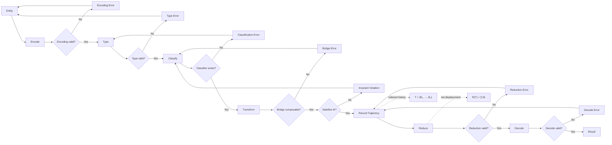

## Workflow

Prime Typed Grammar separates **state**, **transformation**, **history**, and **validation**.

The canonical processing pipeline is:

`Entity → Encode → Type → Classify → Transform → Validate → Record → Reduce → Decode → Result`

### Pipeline

#### 1. Encode

Map the structured entity into its canonical prime-lattice state:

`E → C(E)`

A state is represented by a finite-support prime-exponent encoding:

`C(E) = ∏ pᵢ^aᵢ`

where prime identity determines the coordinate dimension and the exponent carries semantic or temporal state.

If canonical encoding fails, processing returns an **Encoding Error**.

#### 2. Type

Check the encoded expression under the master typing judgment:

`Π; Γ; Δ; Φ ⊢ e : τ | ε`

where:

- `Π` is the prime-family environment
- `Γ` is the static type environment
- `Δ` is the store typing
- `Φ` is the active invariant set
- `τ` is the result type
- `ε` is the permissible effect

An invalid judgment produces a **Type Error**.

#### 3. Classify

Select an admissible role-bearing transformation:

`Classifier[ρ, x, y, ε]`

The classifier establishes a typed mapping:

`x → y`

If no compatible classifier exists, processing produces a **Classification Error** and returns to the typing stage.

#### 4. Transform

Apply the corresponding operator and represent the state change as a bridge:

`B(X,Y) = C(Y) / C(X)`

In exponent coordinates:

`b(X,Y) = a(Y) - a(X)`

Compatible bridges compose by addition of displacement:

`b(X,Z) = b(X,Y) + b(Y,Z)`

and invert by negation:

`b(Y,X) = -b(X,Y)`

An incompatible source, target, or bridge composition produces a **Bridge Error**.

#### 5. Validate

Evaluate the proposed transformation against the active invariant set `Φ`.

Only transformations satisfying the required invariants may enter the accepted trajectory.

`X' ⊨ Φ`

A failed check produces an **Invariant Violation** and returns processing to the transformation-selection stage.

#### 6. Record

Once validated, the bridge is committed to the ordered trajectory:

`T = ⟨B₁, B₂, …, Bₙ⟩`

The trajectory preserves **how** the resulting state was reached.

This occurs before reduction so that ordered transformational history is not lost.

#### 7. Reduce

Reduce the validated trajectory to its net prime-lattice displacement:

`R(T) = ∏ Bᵢ`

or, in exponent coordinates:

`r(T) = Σ bᵢ`

For endpoints `X₀` and `Xₙ`:

`R(T) = C(Xₙ) / C(X₀)`

and:

`r(T) = a(Xₙ) - a(X₀)`

If the recorded trajectory cannot produce a valid canonical reduction, processing produces a **Reduction Error** while retaining the recorded trajectory for diagnosis.

#### 8. Decode

Apply the inverse coding to reconstruct the resulting structured entity:

`E' = C⁻¹(X')`

Because the canonical coding is invertible, a valid lattice state determines its corresponding structured state.

If reconstruction fails validation, processing produces a **Decode Error** without discarding the trajectory that produced the state.

### Trajectory equivalence

Different ordered trajectories may produce the same net transformation.

For parallel trajectories `T` and `U`:

`T ~ᴿ U ⇔ R(T) = R(U)`

Their relative trajectory forms a loop:

`L = U⁻¹ ∘ T`

and net equivalence is characterized by the kernel:

`T ~ᴿ U ⇔ L ∈ ker R`

with:

`ker R = { L | R(L) = 1 }`

A kernel loop therefore represents trajectory history that is invisible to net-displacement reduction.

### History and homotopy

Net equivalence does **not** automatically imply that two trajectories are homotopically identical.

The architecture distinguishes:

`Raw Trajectory → Homotopy Class → Net-Displacement Class → Resulting State`

A loop may have zero net displacement:

`R(L) = 1`

while still retaining nontrivial trajectory structure under an invariant-constrained homotopy relation.

Contractibility is therefore a stronger condition:

`L ≃Φ 1ₓ`

than merely belonging to the displacement kernel.

### Error handling

| Failure | Meaning | Recovery point |
|---|---|---|
| **Encoding Error** | Entity cannot be encoded canonically | Entity input |
| **Type Error** | Typing judgment fails | Entity / type environment |
| **Classification Error** | No admissible typed classifier exists | Typing |
| **Bridge Error** | Transformation endpoints do not compose | Classification |
| **Invariant Violation** | Proposed transformation violates `Φ` | Classification / transformation |
| **Reduction Error** | Recorded trajectory cannot reduce canonically | Recorded trajectory |
| **Decode Error** | Reduced state cannot reconstruct a valid entity | Recorded trajectory |

### Core processing rule

> **Validate before record; record before reduce.**

Failed transformations do not modify the accepted trajectory. Once a transformation is admissible, its bridge is recorded before reduction.

This preserves the distinction between:

- **state** — where the entity is,
- **transformation** — how its encoded state changes,
- **trajectory** — the ordered history of those changes,
- **reduction** — the net displacement produced by that history.

The complete successful path is therefore:

`E → C(E) → typed transformation → Φ-valid bridge → trajectory T → R(T) → C⁻¹ → E′`
